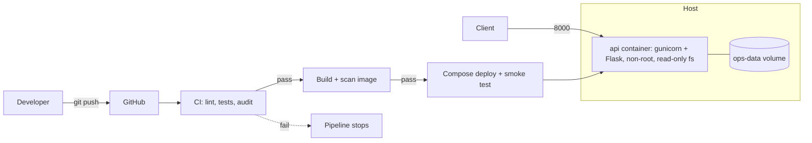

# Apex Operations API

A small Flask API packaged for a reproducible path from commit to release: Docker, Docker Compose,
a GitHub Actions pipeline that blocks bad builds, versioned images with a scripted rollback, and
basic observability.

## What it does

| Endpoint | Purpose |
|---|---|
| `GET /health` | Liveness: the process is running |
| `GET /ready` | Readiness: the database answers (503 if not) |
| `GET /version` | Which release is running |
| `GET /metrics` | Prometheus-style metrics |
| `POST /operations` | Create an operation (needs `X-API-Key`) |
| `GET /operations`, `GET /operations/<id>` | Read operations |

Data lives in SQLite on a Docker volume, so it survives container restarts and rollbacks.

## Architecture



## Run it (about 5 minutes)

Requirements: Docker with Compose v2, `curl`, and Python 3.12 only if you want to run tests outside Docker.

```bash
cp .env.example .env            # then edit API_KEY to any long random value
docker compose up -d --build
curl localhost:8000/health
scripts/smoke.sh                # end-to-end check
docker compose down             # add -v to also delete the data volume
```

## Tests and lint

```bash
make setup      # installs dev dependencies and creates .env
make lint       # ruff
make test       # 11 automated tests with coverage
make test-fail  # same tests with the intentional failure switched on (DEMO_FAIL=1)
```

The intentional failure is `test_intentional_failure_demo`. It passes normally and fails when
`DEMO_FAIL=1`. In GitHub: Actions > CI > Run workflow > tick `demo_fail`. The `test` job goes red and the
`build` and `deploy-local` jobs are skipped, which proves a failing test blocks the release.

## Release and rollback

Images are tagged with a version (`apex-ops-api:1.0.0`), never `latest`. The scripts remember the current
and previous version in `.release/`.

```bash
scripts/deploy.sh 1.0.0                              # first release
scripts/deploy.sh 1.1.0                              # normal upgrade
FAULT_INJECTION=not_ready scripts/deploy.sh 1.2.0    # simulated bad release: fails readiness,
                                                     # rolls back to 1.1.0 automatically
scripts/rollback.sh                                  # manual rollback to the previous version
curl localhost:8000/version                          # confirm what is running
```

`FAULT_INJECTION` is a demo switch that is off by default. See `RUNBOOK.md` for the full procedure.

## Documents

- `RUNBOOK.md` - deploy, rollback, incident response, troubleshooting
- `docs/DECISIONS.md` - decision memo with trade-offs
- `docs/SECURITY.md` - secrets, least privilege, scanning, cloud cost path
- `docs/OBSERVABILITY.md` - logs, metrics, alert proposal
- `docs/FAILURE_INVESTIGATION.md` - one worked failure investigation
- `docs/AI_DISCLOSURE.md` - how AI assistance was used
- `evidence/` - screenshots and logs proving each claim (see `evidence/README.md`)

## Known limitations

SQLite means one running instance; metrics counters are per process; the "deploy" is local Compose, not a
real cloud. All are deliberate trade-offs explained in `docs/DECISIONS.md`.
